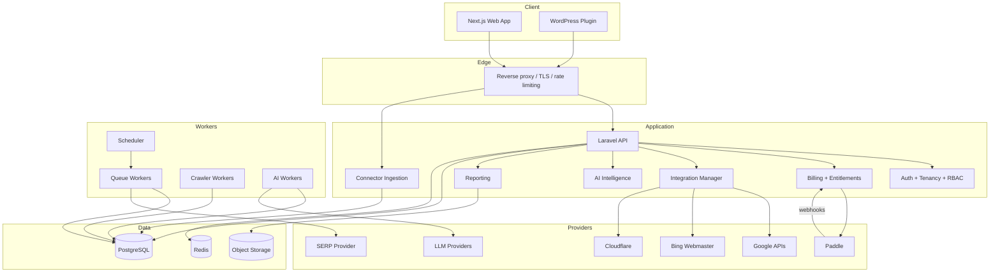

# Target System Architecture

## Architecture goals

The target architecture must support:

- 1 to 100+ sites per organization
- background crawling and integrations
- metered expensive operations
- reliable WordPress ingestion
- subscription and lifetime billing
- agency client access
- AI workloads with evidence and cost controls
- clear separation between operational data and derived intelligence

## Logical components



## Component responsibilities

### Next.js app

Responsible for:

- dashboard UX
- filters/date ranges
- data visualizations
- onboarding
- Paddle.js checkout launch
- plan/usage UI
- agency workspace

Not responsible for:

- deciding entitlements
- storing provider secrets
- verifying billing state
- tenant authorization
- direct Paddle API requests using server API key

### Laravel API

System of record for:

- users, organizations, memberships
- sites
- integrations
- synchronized data
- crawler results
- plan and entitlement decisions
- local billing projection
- reports
- AI evidence and outputs
- license activation

### Redis

Use for:

- queues
- rate limiting
- short-lived locks
- connector nonce replay defense
- short-lived cache
- streaming/conversation coordination where needed

Redis should not be the only copy of billing, entitlements or customer data.

### PostgreSQL

Use for durable operational and analytical storage. Partition or archive high-volume daily/snapshot tables when scale demands it.

### Object storage

Use for:

- report PDFs/exports
- uploaded logos
- knowledge source files
- optional crawl artifacts such as HTML snapshots when explicitly enabled

Do not store every crawled HTML body indefinitely by default.

## Domain boundaries

Recommended Laravel domains/services:

```text
Auth
Organizations
Sites
Billing
Entitlements
Licenses
Integrations
Ingestion
Search
Crawler
RankTracking
AiVisibility
Traffic
Performance
Commerce
Insights
Reports
Automations
Observability
Admin
```

Each domain should expose services/contracts rather than reaching across unrelated models directly.

## Data freshness classes

| Data | Expected freshness |
|---|---|
| WooCommerce event updates | minutes |
| WooCommerce reconciliation | hourly/daily |
| Cloudflare | 15 min–hourly depending plan |
| GA4 | hourly/daily |
| GSC | daily; respect provider delay |
| Bing | daily |
| PageSpeed | daily/on-demand |
| crawl | daily/weekly/plan-defined |
| rank tracking | daily/plan-defined |
| AI visibility | daily/weekly/plan-defined |
| uptime | 1–10 minutes depending plan |

## Multi-tenant isolation

Tenant scoping must be enforced in the API layer and model/query layer, not only hidden in the UI.

Rules:

- every tenant row has `organization_id` or is reachable only through a tenant-owned parent
- cross-tenant IDs return 404 where appropriate
- background jobs carry organization/site IDs and establish tenancy before queries
- connector credentials resolve directly to one site/organization
- admin tools use a separate explicit privileged path

## Scaling strategy

### Stage 1 — single cluster

- Laravel API
- Next.js app
- PostgreSQL
- Redis
- 1–N queue workers
- crawler workers separated by queue

### Stage 2 — workload queues

Split queues:

```text
critical
connector
integrations
crawler
rank
ai
reports
email
low
```

### Stage 3 — high-volume storage tuning

- partition daily observation tables by month/organization/site where useful
- materialize portfolio summaries
- archive raw crawl observations while keeping issue history
- add read replicas only when actual load requires them

## Architecture rules

1. Prefer provider adapters behind interfaces.
2. Store raw provider IDs but expose internal IDs to the frontend.
3. Every external sync must be idempotent.
4. Every high-cost action must be metered before dispatch.
5. Every job must have retry and dead-letter/failed-job handling.
6. Never make user requests wait for a full crawl or historical backfill.
7. Treat billing webhooks as asynchronous state events, not trusted redirects.
