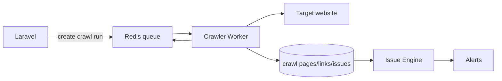

# Technical Site Crawler

## Goal

Build a focused crawler optimized for WordPress technical SEO and change monitoring, not a global internet crawler.

## Architecture

The crawler is an internal worker service/queue workload controlled by Laravel.



## Crawl run configuration

```text
site_id
max_pages
max_depth
concurrency
request_timeout
respect_robots
user_agent
include_patterns
exclude_patterns
render_javascript false by default
```

## Discovery sources

1. site homepage
2. XML sitemap(s)
3. internal links
4. WordPress REST/list data where plugin can safely provide known public URLs

Sitemap discovery should reduce wasted crawling and improve orphan detection.

## Page checks

### HTTP/network

- status
- redirect chain
- response time
- content type
- content length
- HTTPS

### Indexability

- robots meta
- X-Robots-Tag
- canonical
- robots.txt allowance
- canonical target status
- sitemap membership

### Metadata

- title
- meta description
- H1 count/value
- heading structure summary
- lang
- hreflang

### Content

- word count
- text hash
- duplicate title/description/content candidates
- thin page heuristic

### Links

- internal links
- external links
- broken targets
- redirecting internal links
- nofollow
- anchor summary

### Images

- missing alt
- width/height where observable
- oversized response size
- lazy-loading attribute
- broken image

### Structured data

- schema types detected
- JSON-LD parse errors

### WordPress-aware checks

- common pagination/faceted traps
- attachment pages
- author/date archives
- tag/category indexability
- REST-discoverable URL mismatch
- sitemap health

## JavaScript rendering

Do not enable headless-browser rendering for every crawl.

Use a two-tier model:

1. HTTP HTML crawl by default
2. render selected pages only when:
   - HTML is near-empty
   - critical content differs
   - user enables JS rendering on eligible plan

JS rendering is expensive and must be metered.

## Crawl frontier

Maintain normalized URL keys. Remove fragments. Normalize default ports, host case and trailing rules carefully without incorrectly merging meaningful URLs.

## Politeness and safety

- respect robots by default
- per-host concurrency limits
- delay/backoff on 429/503
- identify crawler with a documented user-agent
- stop runaway parameter spaces
- hard page/time budget per run

## Issue engine

Each issue has:

- code
- severity
- category
- affected resource
- evidence
- recommended fix
- first seen
- last seen
- status

Severity is not purely technical. A missing title on a page with 100k GSC impressions should rank above the same issue on an unvisited archive page.

## Site Health score

Do not use a mysterious single score.

Suggested score components:

```text
Crawlability / indexability      30%
On-page fundamentals             20%
Links / redirects                15%
Performance / CWV                15%
Security / availability          10%
Structured data / content hygiene 10%
```

Weight issues by affected high-value pages and severity.

Display the score breakdown.

## Change monitoring

Compare successive crawl observations:

- title changed
- canonical changed
- noindex added/removed
- status changed
- H1 changed
- schema disappeared
- internal-link count changed sharply
- content hash changed

Critical changes can trigger alerts.

## Crawl schedules by plan

Example:

- Starter: weekly
- Growth: daily
- Agency: daily + configurable windows
- manual crawl: cooldown and quota

## Acceptance criteria

- crawl cannot exceed configured page budget
- retries do not create duplicate page/issues
- issue lifecycle can show new/fixed/ignored
- high-value pages are prioritized using GSC where available
- crawl errors are isolated per URL and do not crash the entire run
