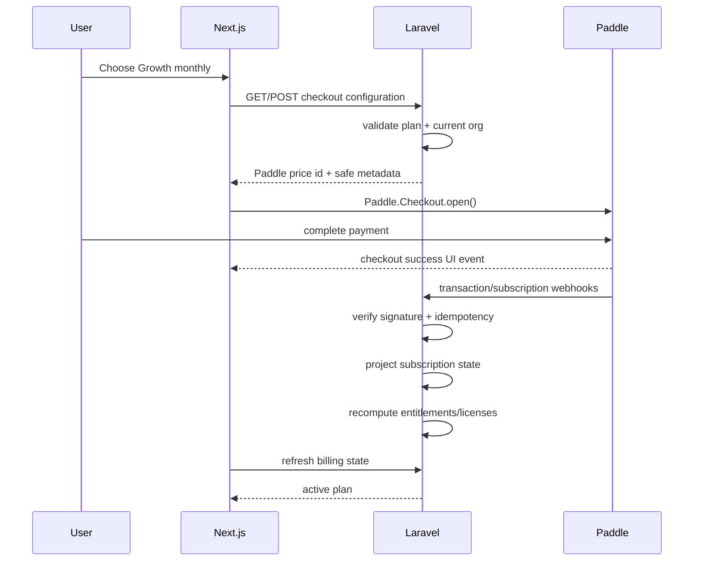

# Paddle Billing Integration Specification

## Decision

Paddle Billing is the target payment and subscription system for Insightistic.

Paddle is a strong fit because it acts as merchant of record for digital products/SaaS, handling payment processing, indirect tax calculation/collection/remittance, compliant invoices, and related billing obligations across supported markets.

## Recommended SDK

For the current Insightistic migration, use the official Paddle PHP SDK (`paddlehq/paddle-php-sdk`) behind a thin billing service. Paddle also documents Laravel Cashier Paddle as a Laravel-native option; the official SDK is preferred here during migration because Insightistic already has a custom billing/entitlement domain and may temporarily support both Stripe and Paddle. See `22A-PADDLE-LARAVEL-IMPLEMENTATION-GUIDE.md`.

## Integration principles

1. **Paddle is the billing system of record; Insightistic is the entitlement system of record.**
2. Frontend uses Paddle.js/client-side token only.
3. Laravel uses Paddle API key only on the server.
4. Access changes are driven by verified webhooks and reconciliation, not by browser success redirects.
5. Every webhook is idempotent by Paddle `event_id`.
6. Store provider-neutral billing state locally.
7. Use Paddle Sandbox for local/staging and completely separate live credentials/catalog.

## Paddle entities used

### Product

Represents sellable product/tier family.

Recommended catalog options:

- Insightistic Starter
- Insightistic Growth
- Insightistic Agency
- Insightistic Agency Pro
- Founder LTD Tier 1
- Founder LTD Tier 2
- Founder LTD Tier 3
- Insight Credits packs

You may instead map multiple plan price types to fewer products, but local `plan_prices` remains the source mapping.

### Price

Use separate Paddle price IDs for:

- monthly recurring
- yearly recurring
- lifetime one-time
- credit pack one-time

### Customer

Map one Paddle customer to an Insightistic organization billing owner where practical.

### Subscription

Only recurring plans create subscriptions.

### Transaction

All revenue flows through Paddle transactions. One-time LTD and credit packs are represented by completed transactions without a recurring subscription.

## Environment variables

Recommended:

```dotenv
BILLING_PROVIDER=paddle

PADDLE_ENV=sandbox
PADDLE_API_KEY=
PADDLE_CLIENT_TOKEN=
PADDLE_WEBHOOK_SECRET=
PADDLE_API_VERSION=1

PADDLE_DEFAULT_CURRENCY=USD
INSIGHTISTIC_APP_URL=https://app.insightistic.com
```

Production must use separate live values.

## API authentication

Paddle API keys are server-only Bearer credentials. Client-side tokens are specifically for Paddle.js and may be exposed in frontend code.

Use least-privilege API-key permissions. At minimum the exact permissions depend on operations implemented, but the key will typically need read/write access to subscriptions/transactions/customer portal-related entities used by the app.

Set key expiry/rotation policy and monitor expiration.

## Checkout architecture

### Recommended frontend approach

Use `@paddle/paddle-js` and `Paddle.Checkout.open()`.

The frontend receives safe checkout configuration from Laravel:

```json
{
  "price_id": "pri_...",
  "customer": {
    "email": "owner@example.com"
  },
  "custom_data": {
    "organization_id": 123,
    "plan_slug": "growth",
    "purchase_kind": "subscription"
  }
}
```

Use Paddle custom data only as a convenient correlation hint. The webhook handler must validate referenced internal organization/plan values server-side before applying them.

### Server-created transaction option

For workflows needing tighter control, Laravel can create a Paddle transaction and the frontend opens checkout using its transaction ID.

This is useful for:

- one-time founder/LTD offers
- custom discounts
- credit packs
- future invoice/sales-assisted flows

## Recurring checkout flow



Success event is UX only; it does not grant plan access before webhook/reconciliation confirms state.

## Webhook endpoint

Recommended:

```text
POST /api/billing/webhook/paddle
```

### Signature verification

Use the raw request body and `Paddle-Signature` header. Paddle signs `timestamp:rawBody` using HMAC-SHA256 with the notification destination secret.

Do not parse/re-encode JSON before verification.

### Response time

Verify, persist minimal event record/queue job, then return 200 promptly. Heavy processing should be queued.

## Webhook events

Minimum recommended subscriptions:

### Recurring billing

- `subscription.created`
- `subscription.updated`

Paddle documents `subscription.updated` as the catch-all for many lifecycle changes. Dedicated lifecycle events may also be subscribed to for operational clarity:

- `subscription.activated`
- `subscription.trialing`
- `subscription.past_due`
- `subscription.paused`
- `subscription.resumed`
- `subscription.canceled`

### Transactions

- `transaction.completed` — required for one-time LTD/credit fulfillment and transaction ledger
- `transaction.payment_failed`
- optionally `transaction.past_due`

### Customer

- `customer.created`
- `customer.updated`

## Idempotency

Insert `event_id` into `billing_events` with a unique constraint before projection.

Pseudo-flow:

```php
if (! BillingEvent::insertOrIgnore(['provider_event_id' => $eventId, ...])) {
    return; // duplicate
}

dispatch(new ProcessPaddleEvent($eventId));
```

The job itself must also be convergence-safe because operators may deliberately replay/reconcile events.

## Subscription state mapping

Paddle subscription statuses include states such as active, trialing, past_due, paused and canceled.

Normalize locally:

```text
trialing -> trialing
active -> active
past_due -> payment_failed / past_due policy state
paused -> paused
canceled -> canceled
```

Do not treat a scheduled cancellation as already canceled. Read `scheduled_change` and keep access active through the effective/current paid period according to policy.

## Cancellation

Paddle cancellation can be immediate or at next billing period.

Recommended self-service behavior:

- default: cancel at next billing period
- show effective date
- continue access until effective date

Important difference from current Stripe implementation: Paddle documents canceled subscriptions as not reinstatable. If user cancels and later wants access again, create a new subscription. Do not model "reactivate canceled subscription" the same way as the current Stripe cancel-at-period-end toggle.

If a future cancellation is only scheduled and has not taken effect, use the provider-supported scheduled-change management flow rather than assuming Stripe semantics.

## Pause/resume

Paddle supports pausing and resuming subscriptions via API. Pausing is not a customer-portal self-service action according to current Paddle docs, so only expose pause if Insightistic intentionally builds this workflow.

Recommended initial release:

- do not expose pause until subscription policy is clear
- support cancel + new checkout for return
- add pause/resume in a later retention phase

## Plan changes

Use Paddle subscription update API with the complete desired item list and explicit proration billing mode.

Rules:

- server decides allowed target plan
- preview price change where possible before confirmation
- update provider
- wait for webhook/projection
- do not directly mutate entitlement plan before provider confirmation unless implementing a clearly-defined optimistic path

## Customer portal

Paddle includes a customer portal for:

- payment method updates
- invoices/payment history
- subscription management/cancellation workflows

Use temporary authenticated portal/deep links returned by Paddle. Do not store temporary management URLs long-term.

Billing page can have:

- current plan
- renewal date
- usage
- upgrade/downgrade
- Manage billing → Paddle portal
- cancellation state

## Trials

Recommended product choice:

- use local free plan for product-led onboarding
- paid-plan trials only if marketing validates the need

If Paddle trial prices are used, subscription events must handle `trialing` and transition to `active`/`past_due` correctly.

## Lifetime deals

LTD is **one-time Paddle price**, not a fake $0 recurring subscription.

Flow:

1. checkout one-time LTD price
2. `transaction.completed`
3. verify price mapping and custom data
4. create durable `entitlement_grant`
5. generate/upgrade license activation allowance
6. do not create local subscription

If refunded/reversed later, entitlement revocation must be supported through adjustments/refund event handling or periodic transaction reconciliation.

## Credit packs

One-time price mapping:

```text
price_id -> credit amount
```

On `transaction.completed`:

- create transaction ledger row
- atomically add credits
- record source transaction ID UNIQUE to prevent double-credit

Never add credits from frontend checkout-success callback.

## Tax / invoices

Paddle acts as merchant of record and handles applicable indirect taxes and compliant invoices. Insightistic should still retain local transaction references and show links/portal access rather than generating conflicting tax invoices itself for Paddle transactions.

## Billing reconciliation

Scheduled job, e.g. daily:

```text
for organizations with Paddle subscription:
  fetch current subscription
  compare provider status/price/billing period
  repair local projection
  log drift
  recompute entitlements if changed
```

Also reconcile recent transactions for one-time purchase fulfillment.

## Security checklist

- server API key never in Next.js bundle
- client token only in frontend
- webhook raw-body signature verification
- event ID unique constraint
- custom_data never trusted without validation
- API key least privilege
- sandbox/live separated
- webhook secret separate per destination/environment
- logs redact credentials and buyer-sensitive fields

## Testing checklist

Use Paddle Sandbox + webhook simulator.

Test:

- recurring purchase
- duplicate webhook
- events out of order
- plan upgrade
- plan downgrade
- cancel at period end
- cancellation becomes effective
- past due/payment failure
- customer portal
- LTD one-time purchase
- credit pack purchase
- failed checkout does not provision
- refund/adjustment policy
- webhook signature failure
- reconciliation repairs missing webhook

## Official Paddle references

- API authentication: `https://developer.paddle.com/api-reference/about/authentication`
- Paddle.js checkout: `https://developer.paddle.com/paddle-js/methods/paddle-checkout-open`
- Transactions: `https://developer.paddle.com/build/transactions/create-transaction`
- Webhooks: `https://developer.paddle.com/webhooks/`
- Signature verification: `https://developer.paddle.com/webhooks/about/signature-verification/`
- Provision access: `https://developer.paddle.com/build/subscriptions/provision-access-webhooks/`
- Cancel subscription: `https://developer.paddle.com/build/subscriptions/cancel-subscriptions/`
- Pause/resume: `https://developer.paddle.com/build/subscriptions/pause-subscriptions/`
- Customer portal: `https://developer.paddle.com/concepts/sell/customer-portal/`
