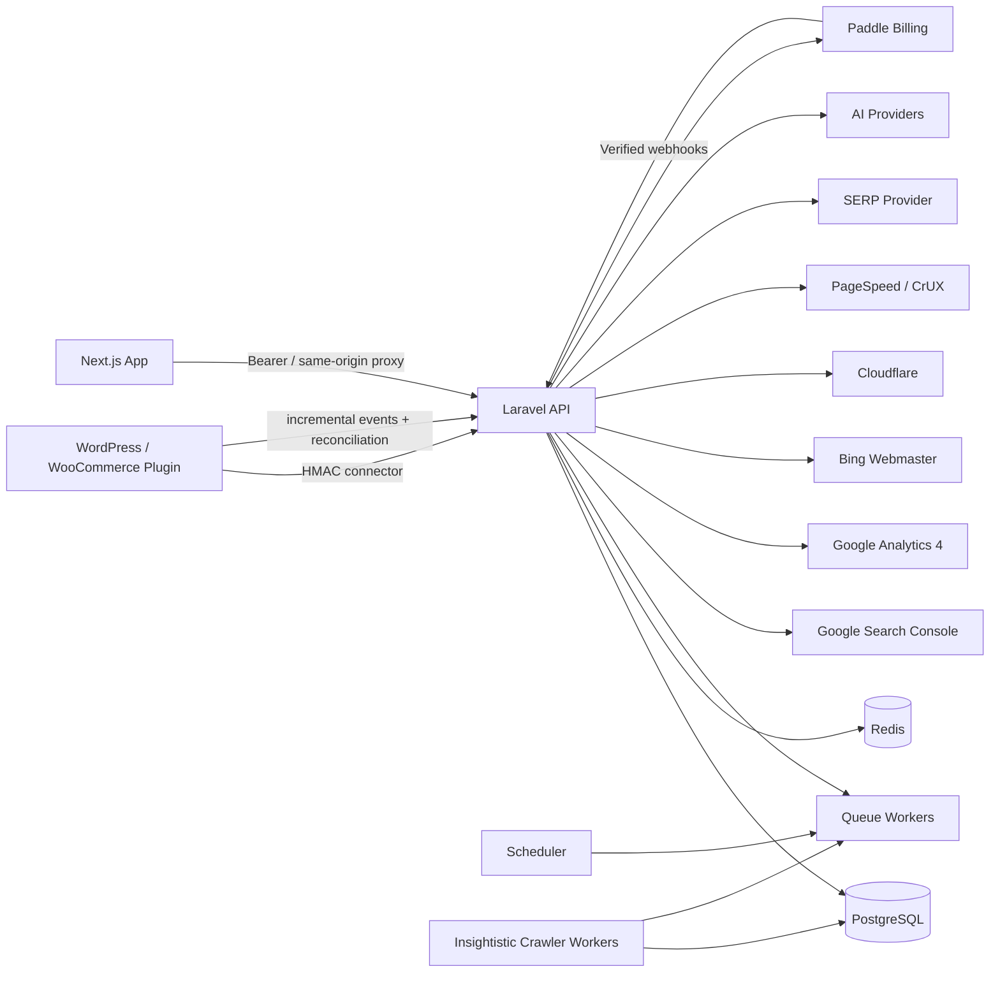

# Insightistic Master Product & Engineering Specification

## 1. Product definition

Insightistic is a multi-tenant SaaS and WordPress integration platform that connects search visibility, technical website health, traffic, infrastructure signals, AI-search presence, and commercial outcomes.

### Product category

**WordPress-first Search + AI Visibility + Performance Intelligence.**

### Core promise

A user should be able to connect a WordPress website and answer five questions from one place:

1. **Can search engines and AI systems discover and understand my site?**
2. **Is my organic visibility improving or declining?**
3. **Is my site technically healthy, fast, available, and crawlable?**
4. **Where is traffic coming from, including bots and AI referrals?**
5. **Which issues or opportunities have the highest business impact?**

For WooCommerce sites a sixth question is added:

6. **How are search, performance and traffic changes affecting revenue, products and customers?**

## 2. Product boundaries

Insightistic should not attempt to build a global web index comparable to Ahrefs or Semrush. It should prefer first-party or customer-authorized data wherever possible.

### Build internally

- technical site crawler
- GSC/Bing intelligence
- Cloudflare edge intelligence
- WordPress/WooCommerce connector
- site-health scoring
- AI visibility orchestration and analytics
- business-impact correlation
- alerts and automation
- agency reporting
- evidence-grounded AI Copilot

### Buy or meter externally

- third-party SERP data where direct search APIs are insufficient
- high-cost AI inference
- high-scale backlink data if offered later
- email delivery infrastructure if required beyond current mail stack

These variable-cost features must be tied to quotas or credits.

## 3. Current technical foundation

The application repository currently contains a Laravel 12 API and a Next.js frontend. PostgreSQL and Redis are part of the documented production architecture. The API already includes multi-tenancy, authentication, role enforcement, billing, reporting, AI, integrations, and WordPress connector endpoints.

The WordPress plugin currently includes GA4, GSC, PageSpeed, Cloudflare, WooCommerce, AI integrations, secure SaaS activation, HMAC requests, sync orchestration, encryption, release tooling and tests.

The principal problem is not that nothing exists. The problem is that the current capabilities are not yet organized into a coherent search-intelligence product, and some commercial assumptions conflict between the SaaS and plugin.

## 4. Target architecture



## 5. Primary product modules

### Overview

One cross-source project health view. It must not be WooCommerce-only. WooCommerce data becomes a contextual module when the site supports it.

### Search Intelligence

- search performance
- winners/losers
- opportunities
- query/page explorer
- index coverage
- rank tracker
- Bing Webmaster
- IndexNow

### AI Visibility

- prompt tracking
- brand mentions
- citation tracking
- competitor share
- provider trends
- AI crawler activity
- AI referral traffic

### Site Audit

- crawl overview
- pages
- links
- images
- metadata
- schema
- canonical/indexability
- change detection
- prioritized issues

### Performance

- Core Web Vitals
- PageSpeed history
- regression alerts
- uptime
- SSL/domain checks
- Cloudflare performance

### Traffic

- GA4
- landing pages
- acquisition
- geographic/device data
- Cloudflare edge traffic
- AI referrals

### WooCommerce

- revenue
- orders
- products
- customers
- stock
- refunds
- retention
- search-to-revenue analysis

### Intelligence

- proactive insights
- Copilot
- alerts
- automation rules
- recommended actions

### Agency

- multi-site portfolio
- client access
- scheduled reports
- white-label
- shareable reports
- custom domain on highest plan

## 6. Billing decision

**Paddle Billing is the target billing system.**

Paddle is used for:

- recurring subscriptions
- one-time lifetime offers
- one-time credit packs
- invoices/customer portal links where applicable
- taxes/VAT/GST as merchant of record
- billing localization
- subscription lifecycle events

Application access must never depend on a checkout-success browser redirect. Provisioning is driven by verified Paddle webhooks and local reconciliation.

The billing implementation must remain provider-aware but product entitlements must be provider-neutral.

## 7. Entitlement decision

A plan is a product concept; Paddle prices are billing identifiers.

```text
Plan
  -> feature entitlements
  -> numeric limits
  -> active price mappings
  -> license activation limit
  -> metering rules
```

The WordPress plugin must consume entitlements from the SaaS. It must not independently decide which modules are premium.

## 8. Lifetime deal model

Lifetime access means permanent access to the purchased feature tier, subject to fixed recurring usage allowances. It does **not** mean unlimited recurring compute.

Variable-cost features use credits or explicit periodic quotas. LTD plans are implemented as one-time Paddle prices that map to permanent local entitlement records.

## 9. Delivery strategy

The project should be delivered in dependency order:

1. architecture cleanup + Paddle foundation
2. new information architecture / UI shell
3. search intelligence expansion
4. Bing + IndexNow
5. technical crawler
6. Cloudflare intelligence
7. rank tracking
8. AI visibility
9. performance/uptime expansion
10. agency/reporting
11. automation
12. LTD launch hardening

Detailed phase gates are defined in `31-IMPLEMENTATION-PHASES.md`.

## 10. Non-negotiable engineering rules

- all tenant-owned data must be tenant-scoped server-side
- all provider secrets encrypted at rest
- no raw Paddle API key in frontend code
- Paddle webhooks verified against the raw request body
- webhook processing idempotent by Paddle event ID
- expensive jobs must be queued
- ingestion endpoints idempotent
- plan limits checked server-side
- WordPress inputs sanitized; output escaped; state changes nonce/capability protected
- Next.js UI must handle loading, empty, degraded, stale and error states explicitly
- no feature is considered complete without tests and operational visibility
